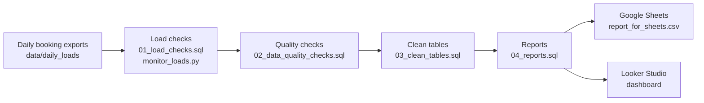

# Visitor Data Quality Pipeline

> **All data in this project is SYNTHETIC.** "Playful Minds Museum" is a fictional children's
> museum in Dubai. Every booking, waiver, feedback response and ID was made up by
> [generate_data.py](generate_data.py). There are no real people, names or emails anywhere.

## The problem

A museum's reports are only as good as the data underneath them. Booking, waiver and
feedback data arrives from different systems every day, and things go wrong:
a day's export never arrives, the same file gets loaded twice, a booking is saved twice,
someone enters a negative amount, a family arrives without a signed safety waiver.

If nobody catches these, the dashboard quietly shows the wrong visitor numbers and the
wrong revenue. This project checks the data **before** it reaches a report, removes or fixes
what is wrong, explains each problem in plain English, and only then builds the reports.

## The fictional museum

**Playful Minds Museum, Dubai** – 60 days of data (1 Sep to 30 Oct 2026).

| Data | What it is | Rows |
|---|---|---|
| `bookings.csv` | One row per booking: date, visit date, time slot, ticket type, party size, amount (AED), channel | 1,792 |
| `waivers.csv` | One safety waiver per booking, signed yes/no | 1,765 |
| `feedback.csv` | Guest ratings (1–5) by category: exhibits, staff, cleanliness, cafe, price | 636 |
| `daily_loads/` | The same bookings split into one export file per day, like a nightly system export | 60 files |
| `injected_errors.csv` | The answer key: every error that was added on purpose | 116 |

Ticket types: child, adult, family pack, annual pass. Channels: website, walk-in, partner.
Weekends (Saturday and Sunday) are busier than weekdays.

## How the data flows



1. **Load checks** – did every day's file arrive, exactly once, with a normal number of rows?
2. **Quality checks** – are there bad rows inside the data?
3. **Clean tables** – copies of the data with the bad rows removed or fixed. The raw data is never changed.
4. **Reports** – built only from the clean tables.
5. **Sheets and dashboard** – what museum staff actually look at.

## Project files

| File | What it does |
|---|---|
| [generate_data.py](generate_data.py) | Creates the synthetic data and adds known errors |
| [sql/01_load_checks.sql](sql/01_load_checks.sql) | Rows per day, missing days, days loaded twice |
| [sql/02_data_quality_checks.sql](sql/02_data_quality_checks.sql) | One query per problem type, returns the bad rows with an `issue` label |
| [sql/03_clean_tables.sql](sql/03_clean_tables.sql) | Builds `clean_bookings`, `clean_waivers`, `clean_feedback` |
| [sql/04_reports.sql](sql/04_reports.sql) | Report views: visitors per day, busiest slots, revenue, waiver completion, ratings, daily summary |
| [run_checks.py](run_checks.py) | Runs all the SQL locally in DuckDB and writes the Excel report and the Sheets CSV |
| [monitor_loads.py](monitor_loads.py) | Checks the daily export folder for missing, duplicate and unusually small or large days |
| [tests/test_pipeline.py](tests/test_pipeline.py) | Proves every injected error is caught and the clean tables are clean |

### What each SQL file does

**01_load_checks.sql** reads `raw_daily_loads` (all daily files stacked together; each row
records which file it came from in `export_id`).
- `rows_per_day` – how many files and rows arrived for each day.
- `missing_days` – builds a full calendar and lists days with no file.
- `days_loaded_twice` – days that arrived as more than one file.

**02_data_quality_checks.sql** – every query returns `issue` (plain-English label) and `record_id`
(the booking or feedback to look at). An empty result means no problem.

| Query | Rule |
|---|---|
| `duplicate_bookings` | A booking ID should appear once |
| `bookings_without_signed_waiver` | Every booking needs a waiver marked `yes` |
| `visit_before_booking` | Nobody can visit before they booked |
| `non_positive_amounts` | Every booking should be paid for |
| `child_ticket_without_children` | A child ticket must include at least one child |
| `feedback_for_unknown_booking` | Feedback must belong to a real booking |
| `rating_out_of_range` | Ratings must be 1 to 5 |

**03_clean_tables.sql** – what happens to each problem:

| Problem | Action | Why |
|---|---|---|
| Duplicate booking | **Fixed** – keep one copy | It is the same booking saved twice |
| Visit before booking | **Removed** | We can't know the true date |
| Zero or negative amount | **Removed** | We can't know the true amount |
| Child ticket with 0 children | **Removed** | We can't know the true party size |
| Feedback for unknown booking | **Removed** | Can't be linked to a visit |
| Rating outside 1–5 | **Removed** | Not a valid score |
| No signed waiver | **Kept and reported** | The booking is real; the missing waiver is a safety follow-up, not a data error. Removing it would hide the problem and make the completion rate look like 100% |

Removed rows are not lost: they stay in the raw tables and are listed in the data-quality report
so someone can fix them at the source.

**04_reports.sql** creates views (saved queries that always show the latest clean data):
`rpt_visitors_per_day`, `rpt_busiest_time_slots`, `rpt_revenue_by_ticket_and_channel`,
`rpt_waiver_completion`, `rpt_rating_by_category` and `rpt_daily_summary` (the one that goes to Google Sheets).

All SQL uses only `SELECT`, `CREATE OR REPLACE TABLE ... AS SELECT` and `CREATE OR REPLACE VIEW`,
so it runs in the free BigQuery sandbox (which does not allow `INSERT`, `UPDATE` or `DELETE`).

## Run it locally (works offline)

Needs Python 3.10+.

```powershell
python -m venv .venv
.venv\Scripts\activate            # macOS/Linux: source .venv/bin/activate
pip install -r requirements.txt

python generate_data.py           # optional: data/ is already included
python monitor_loads.py           # check the daily export files
python run_checks.py              # run all SQL, print the summary, write output/
pytest -v                         # prove the checks work
```

`run_checks.py` loads the CSVs into [DuckDB](https://duckdb.org/), a small database that runs
inside Python, using the same table names as BigQuery. It runs the same SQL files. The only
dialect difference is in `missing_days`: DuckDB has no `GENERATE_DATE_ARRAY`, so the script
defines one, and it writes the column alias as `AS t(calendar_day)` instead of `AS calendar_day`.

Outputs:
- `output/data_quality_report.xlsx` – summary sheet plus one sheet per check, listing the bad rows
- `output/report_for_sheets.csv` – one clean row per visit day, ready for Google Sheets

`monitor_loads.py` exits with code 1 when it finds a problem, so a scheduler could send an alert.

## Load into BigQuery (free sandbox)

1. Go to the [BigQuery console](https://console.cloud.google.com/bigquery), create a project
   (no billing needed for the sandbox) and install the [`bq` command-line tool](https://cloud.google.com/sdk/docs/install),
   or use the console's **Create table → Upload** for each file.
2. Create the dataset and load the raw tables (PowerShell):

```powershell
bq mk --dataset playful_minds

$BOOKING = "booking_id:STRING,booking_date:DATE,visit_date:DATE,time_slot:STRING,ticket_type:STRING,adults:INT64,children:INT64,amount_aed:FLOAT64,channel:STRING,customer_id:STRING"

bq load --source_format=CSV --skip_leading_rows=1 --replace playful_minds.raw_bookings data\bookings.csv $BOOKING
bq load --source_format=CSV --skip_leading_rows=1 --replace playful_minds.raw_waivers data\waivers.csv "waiver_id:STRING,booking_id:STRING,signed_at:TIMESTAMP,signed:STRING"
bq load --source_format=CSV --skip_leading_rows=1 --replace playful_minds.raw_feedback data\feedback.csv "feedback_id:STRING,booking_id:STRING,submitted_at:TIMESTAMP,rating:INT64,category:STRING"

# Daily exports: each file is appended, the way a nightly load would work
Get-ChildItem data\daily_loads\*.csv | ForEach-Object {
  bq load --source_format=CSV --skip_leading_rows=1 playful_minds.raw_daily_loads $_.FullName "export_id:STRING,export_date:DATE,$BOOKING"
}
```

3. Open each file in `sql/` in the BigQuery console and run it, in order 01 → 04.
   BigQuery shows each query's result separately. From the command line:
   `Get-Content sql\02_data_quality_checks.sql -Raw | bq query --use_legacy_sql=false`

Sandbox note: tables in the sandbox expire after 60 days. Loading files is free and allowed;
only `INSERT`/`UPDATE`/`DELETE` are blocked.

## Google Sheets and Looker Studio

- **Google Sheets:** File → Import → upload `output/report_for_sheets.csv`, or in BigQuery open
  `rpt_daily_summary` and choose **Export → Explore with Sheets**.
- **Looker Studio:** Create → Data source → BigQuery → `playful_minds` → pick the `rpt_` views.

| | Link | Screenshot |
|---|---|---|
| BigQuery dataset | _add link_ |  |
| Google Sheets report | _add link_ |  |
| Looker Studio dashboard | _add link_ |  |

## Data-quality findings

From `python run_checks.py` on the included data:

**Load checks**
- Exports arrived for 59 of 60 days. **No export arrived for 17 Sep 2026.**
- **8 Oct 2026 was loaded twice** (56 rows instead of 28) – this would have doubled that day's revenue.
- **21 Oct 2026 had only 6 rows** against a typical 28 – the export was probably cut off (found by `monitor_loads.py`).

**Quality checks**
- 15 bookings appeared more than once
- 42 bookings had no signed waiver (12 with no waiver on file, 30 marked not signed)
- 10 bookings had a visit date before the booking date
- 12 bookings had a zero or negative amount
- 9 child tickets had 0 children
- 14 feedback responses were for bookings that don't exist
- 11 feedback ratings were outside 1–5

Every one of these matches `data/injected_errors.csv` exactly: nothing missed, no false alarms.

**Clean tables**
- bookings: 1,792 raw rows → 1,746 clean (15 duplicate copies + 31 bad rows removed)
- waivers: 1,765 → 1,734 (waivers for the 31 removed bookings)
- feedback: 636 → 602 (14 unknown bookings + 11 bad ratings + 9 linked to removed bookings)

**Headlines (clean data only)**
- 6,295 visitors and AED 610,326 revenue
- Waiver completion rate 97.6% – 42 families to follow up with
- 10:30 is the busiest time slot
- Price (3.2 / 5) and cafe (3.45 / 5) score lowest; staff (4.48 / 5) score highest

## Tests

```
pytest -v
16 passed
```

The tests generate fresh data in a temporary folder and check that:
- each SQL check returns **exactly** the rows that were injected for its error type
- the load checks and `monitor_loads.py` find the missing, duplicate and partial days
- the clean tables pass every quality check (re-running `02_data_quality_checks.sql` against them)
- bookings without a signed waiver are kept and counted in the completion rate
- report totals add up to the clean bookings total
